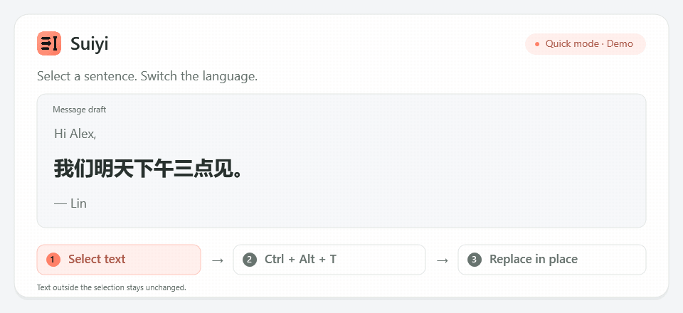

# Suiyi 随译

[简体中文](README.md) · **English**

**Select a sentence. Translate in place.**

Suiyi translates selected text on Windows. In a supported input field, enable Quick Mode, select text, and press `Ctrl+Alt+T` to replace the selection and keep the surrounding text intact.

In supported webpages and other read-only areas, the same shortcut opens the translation window so you can preview and copy the translation. If the selection is unavailable, you can type or paste the source. Turn off Quick Mode to always preview translations first.

<picture>
  <source media="(prefers-color-scheme: dark)" srcset="docs/assets/quick-replace-dark.en.gif">
  <source media="(prefers-color-scheme: light)" srcset="docs/assets/quick-replace.en.gif">
  
</picture>

*Illustrated Quick Mode demo. Requires an editable input field that supports selection capture.*

## Features

- **Quick replacement**: translate and replace your selection with one shortcut.
- **Translation popup**: translate as you type, edit the result, then insert or copy it.
- **Across applications**: insert at the cursor or replace a selection in supported chat apps, browsers, and editors.
- **Flexible translation APIs**: use an OpenAI-compatible Chat Completions service, choose your model, and fetch available model IDs.
- **Smart translation**: choose a primary and another language from 12 options. Primary-language text goes to the other language; all other languages go to your primary language. Adjust the pair from the tray. The Chinese or English interface follows Windows automatically.
- **Ready when you are**: customizable shortcut, tray controls, and startup at login.
- **Color themes**: 10 accent colors, orange by default. Light and dark modes follow Windows, with matching window, taskbar, and tray icons.
- **Local encryption**: API keys are encrypted for your Windows user and stored separately for each API endpoint.
- **Install and update**: installer and portable builds, with in-app updates.
- **Lightweight runtime**: Tauri + Rust with an installer of about 3.7 MiB. Uses shared WebView2, installed automatically when missing.

[Download for Windows](https://github.com/whoarei/suiyi/releases/latest) · [User guide (Chinese)](docs/reference.md) · [Install and update (Chinese)](docs/installation.md) · [Compatibility (Chinese)](docs/compatibility.md) · [Technical design (Chinese)](docs/technical-design.md)
