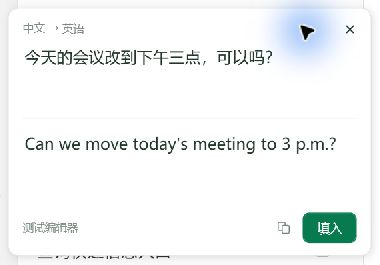

# 随译 Suiyi


一个面向聊天和日常写作的 Windows 翻译浮窗：输入中文并回填译文，或选中已有文字后翻译并替换原选区。



当前已接入 DeepSeek，支持跨应用回填，不再限制进程名单。已实测 WPF 编辑框、Edge 网页多行及富文本输入框；此前也已在 Windows 微信 4.2.0.13 的文件传输助手中跑通完整翻译流程。

- 交互方案：极简浮窗，中文原文与译文上下排列，主按钮按当前场景切换为填入、替换或复制。
- 默认快捷键：`Ctrl+Alt+T` 唤出，`Ctrl+Enter` 回填，`Esc` 收起并保留草稿。
- 技术方向：C#、WPF、.NET 10，优先支持 Windows 11 x64。
- 翻译服务：DeepSeek 官方 API，默认 `deepseek-flash`，关闭思考模式；支持设置为 `deepseek-v4-pro`。
- [完整技术方案](docs/translation-floating-window-plan.md)
- [实测记录和当前限制](docs/compatibility.md)

## 运行

运行 `artifacts\TranslationFloat\TranslationFloat.exe`，程序常驻托盘。

1. 首次使用，从托盘菜单打开“设置”，填写 DeepSeek API Key，测试连接并保存。未配置时浮窗也会提供设置入口。
2. 在准备填写的输入框中放好光标，按 `Ctrl+Alt+T`。
3. 在上方输入中文，停顿约 450 毫秒后自动翻译。下方的完整译文可以手动修改。
4. 按 `Ctrl+Enter` 或点击“填入”。有效译文按当前光标或选区的粘贴规则回填。左下角仅显示目标应用名，详细说明在悬停提示中。
5. 在目标软件中检查文字，再自行决定是否发送或提交。程序仅执行粘贴。

翻译已有文字：在支持选区读取的可编辑输入框中选中文字，按 `Ctrl+Alt+T`，原文会自动进入浮窗并翻译。按 `Ctrl+Enter` 或点击“替换”，只替换原选区，保留前后内容。回填前会复核原控件与选区，变化时停止替换并把译文留在剪贴板。只接受单个不超过 2000 个 UTF-16 代码单元的选区，过长时不会截断替换。

未选中文字时保持手动输入方式。`Esc` 收起后，下一次选区唤出会使用新选中文字；此前来自选区的草稿在无选区唤出时清空，避免误追加到光标处。部分自绘控件（包括目前只暴露顶层窗口的微信界面）未提供可验证的选区，暂时仍需手动把原文放入浮窗；不能保证任意输入框均可自动读取。

成功填入后，浮窗自动清空原文和译文，下次唤出从空白开始。仅复制、取消、回填失败或结果不确定时保留草稿；`Esc` 也会收起并保留尚未填入的内容，中文选词时先取消组合输入。托盘菜单可以打开复制模式、设置或退出。回填会把译文留在剪贴板。不要在不准备替换的文字上保留选区。

从托盘打开时主按钮为“复制”，`Ctrl+Enter` 也会复制；绑定输入位置时，旁边的小复制图标仍可单独复制译文。浮窗不再常驻显示品牌栏、模型名称和快捷键说明；翻译进度放在译文区域，错误与重试仅在需要时出现。重新翻译期间清空界面上的旧译文，并禁用输出。

支持范围是常见的可编辑文本区域，不能保证所有软件的每一个输入框。标准 Edit/RichEdit 检查原生控件状态；其他控件用隔离的 UI Automation 辅助进程识别，回填前复核具体控件身份。已识别的密码、只读、不可用和非输入控件禁止回填。

部分自绘应用只暴露整个窗口，程序无法区分其中的具体字段，会提示用户确认光标；这种路径只保留窗口与原生焦点检查。辅助识别不可用时也可能进入此路径，不保证识别所有自绘密码框。无法恢复目标、控件已变化或权限不足时请复制后手动粘贴。应用名称仅用于显示，不是白名单或兼容性承诺。

原文或模型配置改变后，旧译文立即失效，更新期间不能复制或回填。手动改译文不会被迟到的响应覆盖。多行原文使用一次结构化翻译请求，并校验行数与空行后重建换行；模型返回不完整或格式错误时提供重试。

翻译只发送浮窗中的原文，不采集聊天记录。请求超时为 15 秒；认证、余额、限流、网络和服务端错误分别提示。失败后不自动切换服务商，也不持续自动重试。

## 密钥保存

普通设置位于 `%LOCALAPPDATA%\TranslationFloat\settings.json`；密钥单独保存在同目录的 `deepseek.key`，使用 Windows DPAPI 当前用户范围加密。重新打开设置时，密钥框留空会保留已有密钥。

也可从程序启动环境中的 `DEEPSEEK_API_KEY` 读取密钥。环境变量只作为没有本机已保存密钥时的后备来源。运行包不包含用户配置或密钥。

API 地址固定为 `https://api.deepseek.com/chat/completions`，不将密钥发送到自定义代理地址。单行请求只返回译文，多行请求使用 JSON 行数组；接口依据 [DeepSeek 官方文档](https://api-docs.deepseek.com/api/create-chat-completion/)。

程序只运行一个实例；已经在托盘运行时，再次打开会直接退出新实例，请使用快捷键唤出原实例。

## 开机启动

首次运行默认开启。右键托盘图标，可以勾选或取消“开机启动”；关闭后会记住选择，后续手动启动不会重新开启。登录 Windows 后程序仅驻留托盘。

启动项位于当前用户的 `HKCU\Software\Microsoft\Windows\CurrentVersion\Run`，值名 `Suiyi`；开启偏好保存在 `HKCU\Software\Suiyi\AutoStartEnabled`，无需管理员权限，也不修改 DeepSeek 配置。便携版请放在固定目录；移动目录后手动运行一次，开启状态下会更新路径。删除程序前可先取消勾选。

只读焦点识别辅助进程不会注册开机启动。[Windows 登录启动项说明](https://learn.microsoft.com/en-us/windows/win32/setupapi/run-and-runonce-registry-keys)

## 构建与检查

需要 Windows x64 和 .NET SDK 10.0.404。此工作区的 SDK 保存在 `.tools\dotnet`，没有修改系统 PATH。

```powershell
# 运行回填、翻译协议、调度、原生输入和密钥保存检查，生成自包含运行目录
.\scripts\build.ps1

# 启动到托盘
.\scripts\run.ps1

# 显示初始复制窗口；诊断模式会让浮窗出现在任务栏，便于 UI 测试
.\scripts\run.ps1 -Show -Diagnostics

# 打开 DeepSeek 设置
.\scripts\run.ps1 -Settings
```

自包含目录内的文件需要一起复制。可选 `build.ps1 -FrameworkDependent` 生成依赖已安装 .NET 10 Desktop Runtime 的版本，输出到单独目录。

## 自动发布 Windows 便携版

推送 `vX.Y.Z` 格式的 tag 后，[GitHub Actions](https://github.com/whoarei/suiyi/actions/workflows/release.yml) 自动运行全部检查、构建 Windows x64 自包含便携包，并发布到对应的 [Release](https://github.com/whoarei/suiyi/releases)。例如：

```powershell
git tag -a v0.1.0 -m "随译 v0.1.0"
git push origin v0.1.0
```

Release 包含 `suiyi-0.1.0-windows-x64-portable.zip` 和同名 `.sha256` 校验文件。下载后完整解压，运行 `Suiyi\TranslationFloat.exe`，无需另装 .NET。API Key 仍由使用者在本机设置，构建不需要 DeepSeek 凭据。

`v0.1.0-rc.1` 等带后缀的 tag 自动标为预发布。Actions 页面也支持手动运行，仅生成可下载的构建产物，不创建 Release。失败时可查看运行日志；重新发布已有版本前请先确认现有 Release，流程不会覆盖已有附件。

本地可以用同一个打包脚本生成版本化便携包，输出到 `artifacts\release`：

```powershell
.\scripts\package.ps1 -Version 0.1.0
```

自动检查共 85 项，不调用真实翻译服务，也不读取生产密钥；原生检查不向桌面发送输入。开机启动检查使用隔离的测试注册表分支，不修改真实启动项。真实联调另使用用户在本机保存的凭据，验证 DeepSeek 翻译及跨应用回填。微信测试文字保留在文件传输助手的草稿框，未点击发送；浏览器测试页没有提交功能。

诊断日志位于 `%LOCALAPPDATA%\TranslationFloat\m0.log`，仅记录操作阶段、结果、进程名和窗口句柄，不记录输入文本或聊天内容。

UI Automation 辅助进程默认仅查询控件类型、启用/只读/密码状态和运行时身份；选区唤出及替换前复核会额外读取已确认可编辑控件的选中文字和范围，不读取完整输入值或控件名称。每次最多等待 900 毫秒，超时终止辅助进程。原生 Edit/RichEdit 先确认非空选区，再执行一次 Ctrl+C，只读取本次由目标进程新写入的 Unicode 文本；不会拿旧剪贴板内容翻译，也不恢复旧剪贴板。此兼容路径可能将原选中文字留在剪贴板，成功回填后留下译文。

程序、窗口和托盘使用随译专属的玉绿色互译箭头图标。图标已嵌入运行文件，不依赖外部图片目录；[矢量源稿、尺寸预览与生成方法](docs/assets/README.md)随源码保留。
