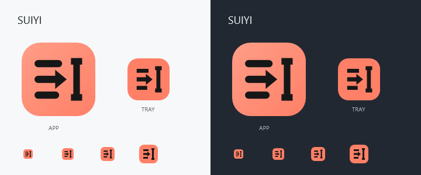

# 随译图标

当前采用「译入光标」方案：圆角方形内，文字横线与向右箭头指向输入光标，表达译文回填到当前输入位置。默认橙色，大尺寸使用轻微渐变；托盘和小尺寸图标使用同形的纯色版本，并按 16 像素网格简化符号。运行时按所选主题生成背景与高对比符号，窗口、任务栏及托盘图标一并更新。



源稿位于 `src/TranslationFloat.App/Assets`：

- `Suiyi.svg`：程序图标的可编辑矢量源稿。
- `Suiyi.Tray.svg`：为小尺寸绘制的矢量源稿。
- `Suiyi.png`：512 像素透明 PNG，用于 README 和品牌预览。
- `Suiyi.ico`：程序与窗口图标，包含 16、20、24、32、40、48、64、96、128、256 像素帧。
- `Suiyi.Tray.ico`：托盘图标，包含 16、20、24、32、40、48 像素帧。

在 Windows 下重新生成：

```powershell
powershell.exe -NoProfile -STA -File scripts/generate-icons.ps1
```

脚本读取 SVG 源稿，使用 Windows 自带的 WPF 渲染，不依赖字体、外部服务或下载的图标库；同时用 Windows 图像解码器校验 ICO 帧。生成的 ICO 和 PNG 直接入库，普通构建无需重新绘图。

默认橙色 ICO 写入可执行文件和安装包。SVG 源稿也嵌入程序集，运行时由 `ThemeIconFactory` 按当前配色生成多尺寸 ICO：窗口使用 WPF 图像，托盘使用原生图标，并在切换后释放旧句柄。

任务栏通过窗口图标和 AppUserModel 图标资源同步。图标文件缓存在 `%LOCALAPPDATA%\TranslationFloat\Icons`；仅刷新目标路径为当前随译程序的开始菜单和任务栏快捷方式，不修改其他应用的快捷方式。

## 快速替换动图

首页动图使用默认橙色主题，展示选中中文、按下快捷键、原位替换为英文的快速模式体验，前后的称呼与署名保持不变。此为绘制的流程示意，包含 108 帧，循环时长 7.2 秒。

- `quick-replace.gif`、`quick-replace-dark.gif`：中文标注的浅色与深色版本。
- `quick-replace.en.gif`、`quick-replace-dark.en.gif`：英文标注的浅色与深色版本。

中英文 README 通过 `<picture>` 按阅读者的深浅偏好选择对应动图。

图形使用 WPF 绘制，以 FFmpeg 编码为 GIF。重新生成需要 Windows 和可用的 `ffmpeg` 命令：

```powershell
powershell.exe -NoProfile -STA -File scripts/generate-readme-demo.ps1
powershell.exe -NoProfile -STA -File scripts/generate-readme-demo.ps1 -Mode Dark
powershell.exe -NoProfile -STA -File scripts/generate-readme-demo.ps1 -Language en
powershell.exe -NoProfile -STA -File scripts/generate-readme-demo.ps1 -Language en -Mode Dark
```
