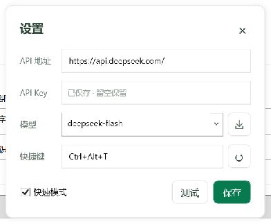

# 使用与开发参考

[软件简介](../README.md) · [安装与升级](installation.md)

开发命令均从仓库根目录执行。

## 运行

推荐下载 [Release](https://github.com/whoarei/suiyi/releases) 中的 Windows x64 安装包 `suiyi-X.Y.Z-windows-x64-setup.exe`。默认安装到当前用户的 `%LOCALAPPDATA%\Programs\Suiyi`，无需管理员权限，提供开始菜单与卸载入口。便携包仍可解压运行，开发构建运行 `artifacts\TranslationFloat\TranslationFloat.exe`，程序常驻托盘。

1. 首次使用，从托盘菜单打开“设置”，填写 API 地址、Key 和模型，点击“测试”后保存。模型可点击右侧下载图标获取后选择，也可手填；无鉴权的本地接口可留空 Key。
2. 在准备填写的输入框中放好光标，按 `Ctrl+Alt+T`。
3. 在上方输入中文，停顿约 450 毫秒后自动翻译。下方的完整译文可以手动修改。
4. 按 `Ctrl+Enter` 或点击“填入”。有效译文按当前光标或选区的粘贴规则回填。左下角仅显示目标应用名，详细说明在悬停提示中。
5. 在目标软件中检查文字，再自行决定是否发送或提交。程序仅执行粘贴。

翻译已有文字：在支持选区读取的可编辑输入框中选中文字，按 `Ctrl+Alt+T`，原文会自动进入浮窗并翻译。按 `Ctrl+Enter` 或点击“替换”，只替换原选区，保留前后内容。回填前会复核原控件与选区，变化时停止替换并把译文留在剪贴板。只接受单个不超过 2000 个 UTF-16 代码单元的选区，过长时不会截断替换。

普通模式下，未选中文字时保持手动输入方式。`Esc` 收起后，下一次选区唤出会使用新选中文字；此前来自选区的草稿在无选区唤出时清空，避免误追加到光标处。部分自绘控件（包括目前只暴露顶层窗口的微信界面）未提供可验证的选区，暂时仍需手动把原文放入浮窗；不能保证任意输入框均可自动读取。

## 快速模式与快捷键

右键托盘图标勾选“快速模式”，也可在设置页开启。首次运行默认关闭，后续记住选择。开启后，选中文字并按唤出快捷键，程序后台调用所设翻译接口并直接替换原选区，全程不显示翻译浮窗，也不需要 Ctrl+Enter。等待时再按一次快捷键可取消；失败、不支持的控件或没有选中文字时，只显示约 3 秒、不抢焦点的提示。

快速模式不会激活已经切走的原窗口。翻译期间窗口、焦点或选区变化时停止替换，不持续重试；部分提交不重放。识别选区的支持范围和 2000 个 UTF-16 代码单元上限与普通模式相同。可在托盘关闭快速模式，继续使用译文预览和手动确认。

设置页只保留 API 地址、Key、模型、快捷键四行，以及快速模式、测试和保存。右上角 × 与 Esc 关闭并放弃未保存修改。点击“快捷键”后直接按下新组合，支持 Ctrl、Alt、Shift 与字母、数字或 F1–F12，至少包含 Ctrl 或 Alt；旁边的 ↺ 恢复 Ctrl+Alt+T，保存后立即生效。录入期间暂时释放当前全局快捷键，离开录入框时恢复注册。新组合被占用时提示更换，保存失败时保留当前快捷键。该设置同时用于普通模式唤出和快速模式翻译，Ctrl+Enter 仍是普通模式的确认键。



快速模式和快捷键偏好保存在当前用户的 `HKCU\Software\Suiyi`，值名分别为 `QuickModeEnabled` 与 `HotKey`；不写入便携包。从托盘打开设置时不会连带显示空白翻译浮窗。

托盘右键菜单采用圆角、主题色悬停和线条图标，按操作分组。“快速模式”和“开机启动”以滑动开关显示当前状态；设置与退出入口保持在同一菜单中。

“主题”子菜单提供蓝、青、绿、青柠绿、黄、橙、粉、洋红、紫、黑十种颜色，默认橙色。更改后立即生效，并保存到当前用户的 `HKCU\Software\Suiyi\ThemeColor`。浅色与深色自动跟随 Windows 的应用颜色模式，切换时保留编辑内容与选区。

托盘菜单中的“检查更新”会查询 GitHub 上最新的正式 Release。有新版安装包时，点击“下载并安装”，程序显示下载进度，校验附件大小与 GitHub 提供的 SHA-256，然后启动安装器并退出；安装完成后重新启动随译。当前操作或设置未结束时，下载会保留，等待点击“安装更新”。关闭窗口可取消下载，失败时可重试。缺少有效安装包摘要的旧 Release 仍提供发布页面入口。查询和下载都不使用翻译接口或 API Key。

安装版覆盖升级及卸载均保留接口配置、加密密钥和快捷键等偏好。首次从 v0.2.0 及更早版本迁移，需要先手动安装一次新版安装包。便携版使用程序内安装更新时会迁移到安装目录，后续从开始菜单运行安装版。[安装与升级说明](installation.md)

成功填入后，浮窗自动清空原文和译文，下次唤出从空白开始。仅复制、取消、回填失败或结果不确定时保留草稿；`Esc` 也会收起并保留尚未填入的内容，中文选词时先取消组合输入。托盘菜单可以打开复制模式、设置或退出。回填会把译文留在剪贴板。不要在不准备替换的文字上保留选区。

从托盘打开时主按钮为“复制”，`Ctrl+Enter` 也会复制；绑定输入位置时，旁边的小复制图标仍可单独复制译文。浮窗不再常驻显示品牌栏、模型名称和快捷键说明；翻译进度放在译文区域，错误与重试仅在需要时出现。重新翻译期间清空界面上的旧译文，并禁用输出。

支持范围是常见的可编辑文本区域，不能保证所有软件的每一个输入框。标准 Edit/RichEdit 检查原生控件状态；其他控件用隔离的 UI Automation 辅助进程识别，回填前复核具体控件身份。已识别的密码、只读、不可用和非输入控件禁止回填。

部分自绘应用只暴露整个窗口，程序无法区分其中的具体字段，会提示用户确认光标；这种路径只保留窗口与原生焦点检查。辅助识别不可用时也可能进入此路径，不保证识别所有自绘密码框。无法恢复目标、控件已变化或权限不足时请复制后手动粘贴。应用名称仅用于显示，不是白名单或兼容性承诺。

原文或接口、密钥、模型配置改变后，旧译文立即失效，更新期间不能复制或回填。手动改译文不会被迟到的响应覆盖。多行原文在提示词中要求返回 JSON 行数组，并校验行数与空行后重建换行；模型返回不完整或格式错误时提供重试。

普通模式只发送浮窗中的原文，快速模式只发送本次主动选中的文字，不采集聊天记录。请求超时为 15 秒；认证、余额、限流、网络和服务端错误分别提示。失败后不自动切换服务商，也不持续自动重试。

## 密钥保存

普通设置位于 `%LOCALAPPDATA%\TranslationFloat\settings.json`，版本 2 保存 API 根地址和模型。密钥按归一化后的 API 地址分别保存在 `api-<地址摘要>.key`，使用 Windows DPAPI 当前用户范围加密；同一地址下留空保留已有密钥，切换地址不会自动携带其他地址的 Key。

密钥输入框右侧的小眼睛可切换显示与隐藏；输入为空时可查看当前地址已保存的密钥。窗口失去焦点时自动隐藏明文，关闭时清空输入控件。切换地址时会清空通过小眼睛加载的已保存密钥，即使它在显示期间被编辑过，也不会自动带到其他地址。

旧版版本 1 设置及 `deepseek.key` 会继续加载原地址、模型和密钥，保存时迁移为通用格式；旧模型名称不经过白名单筛选。`DEEPSEEK_API_KEY` 仅在旧 DeepSeek 地址缺少本机密钥时作为兼容来源，不会用于其他地址。新用户不预填任何地址或模型。运行包不包含用户配置或密钥。

API 地址填写根路径，例如 `https://example.com/v1`；支持已有路径前缀，也可粘贴完整的 `/chat/completions` 地址。翻译请求使用根地址下的 `POST chat/completions`，模型获取使用 `GET models`，只发送用户配置的当前地址及其对应 Key，不跟随重定向。模型列表支持标准 `data[].id` 与游标分页；获取失败仍可手填。列表出现的模型不保证支持聊天翻译，“测试”会分别验证单行和带空行的多行输入。

请求只发送 `model`、`messages`、`stream: false`，不强制 `thinking`、`reasoning_effort`、`temperature`、输出格式或 token 上限等可能不被支持的选项。需要独有协议、额外必填参数或 Responses-only 的模型不在当前通用聊天接口支持范围；模型默认的思考模式和生成策略由服务端决定。

程序只运行一个实例；已经在托盘运行时，再次打开会直接退出新实例，请使用快捷键唤出原实例。

## 开机启动

首次运行默认开启。右键托盘图标，可以勾选或取消“开机启动”；关闭后会记住选择，后续手动启动不会重新开启。登录 Windows 后程序仅驻留托盘。

启动项位于当前用户的 `HKCU\Software\Microsoft\Windows\CurrentVersion\Run`，值名 `Suiyi`；开启偏好保存在 `HKCU\Software\Suiyi\AutoStartEnabled`，无需管理员权限，也不修改翻译接口配置。便携版请放在固定目录；移动目录后手动运行一次，开启状态下会更新路径。删除程序前可先取消勾选。

只读焦点识别辅助进程不会注册开机启动。[Windows 登录启动项说明](https://learn.microsoft.com/en-us/windows/win32/setupapi/run-and-runonce-registry-keys)

## 构建与检查

需要 Windows x64 和 .NET SDK 10.0.404。此工作区的 SDK 保存在 `.tools\dotnet`，没有修改系统 PATH。

```powershell
# 运行回填、翻译协议、调度、原生输入和密钥保存检查，生成自包含运行目录
.\scripts\build.ps1

# 启动到托盘
.\scripts\run.ps1

# 显示初始复制窗口；诊断模式会让浮窗出现在任务栏，便于 UI 测试
.\scripts\run.ps1 -Show -Diagnostics

# 打开接口设置
.\scripts\run.ps1 -Settings

# 启动后打开检查更新窗口
.\scripts\run.ps1 -CheckUpdates
```

自包含目录内的文件需要一起复制。可选 `build.ps1 -FrameworkDependent` 生成依赖已安装 .NET 10 Desktop Runtime 的版本，输出到单独目录。

## 自动发布 Windows 安装包与便携版

推送 `vX.Y.Z` 格式的 tag 后，[GitHub Actions](https://github.com/whoarei/suiyi/actions/workflows/release.yml) 自动运行检查、构建 Windows x64 自包含安装包和便携包，并验证隔离的安装、覆盖升级及卸载流程，再发布到对应的 [Release](https://github.com/whoarei/suiyi/releases)。例如：

```powershell
git tag -a v0.1.0 -m "随译 v0.1.0"
git push origin v0.1.0
```

Release 包含 `suiyi-X.Y.Z-windows-x64-setup.exe`、`suiyi-X.Y.Z-windows-x64-portable.zip` 及各自同名 `.sha256` 文件，均无需另装 .NET。API Key 由使用者在本机设置，构建不需要翻译服务凭据。构建脚本下载固定版本的 Inno Setup 6.7.3 到 `.tools`，校验摘要后以官方便携模式使用，不修改系统 PATH。

`v0.1.0-rc.1` 等带后缀的 tag 自动标为预发布。Actions 页面也支持手动运行，仅生成可下载的构建产物，不创建 Release。失败时可查看运行日志；重新发布已有版本前请先确认现有 Release，流程不会覆盖已有附件。

本地可以用同一个打包脚本生成版本化便携包，输出到 `artifacts\release`：

```powershell
.\scripts\package.ps1 -Version 0.1.0
```

自动检查共 181 项，不调用真实翻译服务，也不读取生产密钥；原生检查不向桌面发送输入。更新检查使用 HTTP 替身覆盖版本排序、正式版筛选、官方链接、下载摘要、重定向、网络错误、限流、取消及响应大小。开机启动和界面偏好检查使用隔离的测试注册表分支，不修改真实启动项或快捷键偏好。密钥可见性检查使用隐藏的设置控件、临时目录与虚构密钥。安装器另用 `scripts/test-installer.ps1 -AppDirectory <自包含目录>` 验证安装、持锁升级和卸载，使用独立 AppId、互斥量、事件、目录及虚构配置。真实翻译联调另使用用户在本机保存的凭据，验证接口翻译及跨应用回填。微信测试文字保留在文件传输助手的草稿框，未点击发送；浏览器测试页没有提交功能。

诊断日志位于 `%LOCALAPPDATA%\TranslationFloat\m0.log`，仅记录操作阶段、结果、进程名和窗口句柄，不记录输入文本或聊天内容。

UI Automation 辅助进程默认仅查询控件类型、启用/只读/密码状态和运行时身份；选区唤出及替换前复核会额外读取已确认可编辑控件的选中文字和范围，不读取完整输入值或控件名称。每次最多等待 900 毫秒，超时终止辅助进程。原生 Edit/RichEdit 先确认非空选区，再执行一次 Ctrl+C，只读取本次由目标进程新写入的 Unicode 文本；不会拿旧剪贴板内容翻译，也不恢复旧剪贴板。此兼容路径可能将原选中文字留在剪贴板，成功回填后留下译文。

程序、窗口和托盘使用随译专属的玉绿色「译入光标」图标，以文字、箭头和输入光标表达译文回填。图标已嵌入运行文件，不依赖外部图片目录；[矢量源稿、尺寸预览与生成方法](assets/README.md)随源码保留。
