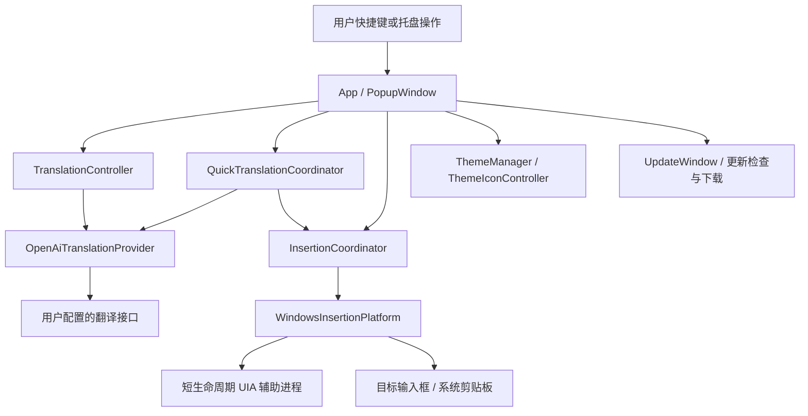
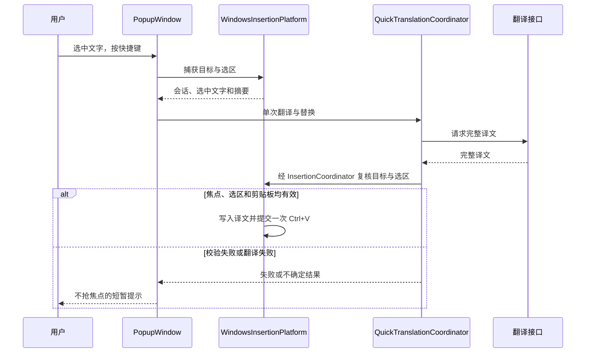

# 随译技术方案（WPF 历史版本）

> 此文记录 v0.2.4 的 WPF 实现。Tauri 重构后的当前方案见 [technical-design.md](technical-design.md)。

本文描述随译 **v0.2.4** 已实现的架构和关键约束，供维护、排障和后续开发使用。更新日期：2026 年 11 月 15 日。

[软件简介](../README.md) · [使用与配置](reference.md) · [安装与升级](installation.md) · [兼容性与实测记录](compatibility.md)

## 1. 产品范围

随译是常驻托盘的 Windows 翻译工具。用户使用现有输入法，通过快捷键在支持的输入框中完成中译英，随后自行确认发送或提交。

| 模式 | 入口与流程 | 输出方式 |
| --- | --- | --- |
| 浮窗模式 | 在输入位置按快捷键；有可读取选区时带入原文，否则手动输入 | 预览、编辑译文，再按 `Ctrl+Enter` 填入或替换 |
| 快速模式 | 选中文字后按同一快捷键 | 后台翻译并替换原选区，不显示浮窗；失败时显示约 3 秒提示 |
| 复制模式 | 从托盘打开，或未能绑定输入位置 | 翻译并复制，由用户手动粘贴 |

默认唤出键为 `Ctrl+Alt+T`，可以自定义；快速模式默认关闭，开机启动默认开启。界面有十种主题色，默认橙色，深浅跟随 Windows 应用颜色模式。

当前目标语言为英语。程序不注册系统输入法，不监听全局逐键文本，不自动发送消息，也不读取整个聊天记录或输入框全文。跨应用支持以控件能力和实测结果为准，不能承诺任意输入框都可读取选区或可靠替换。

## 2. 技术选型与工程组织

| 部分 | 实现 | 选择依据 |
| --- | --- | --- |
| 主界面 | C#、WPF/XAML，`net10.0-windows` | 直接处理 Windows 窗口、文本组合输入和原生互操作 |
| 核心逻辑 | `TranslationFloat.Core`，`net10.0` | 把翻译调度、协议、回填决策和更新校验与桌面 UI 分开验证 |
| 托盘 | WinForms `NotifyIcon`、自绘 `ContextMenuStrip` | 在 WPF 进程内提供托盘菜单、开关与主题子菜单 |
| 快捷键与粘贴 | Win32 `RegisterHotKey`、剪贴板、`SendInput` | 复用目标软件自身的文本粘贴语义 |
| 控件识别 | Win32 原生检查及 UI Automation 辅助进程 | 兼顾标准编辑控件和支持可访问接口的自绘控件 |
| 翻译服务 | `HttpClient`、OpenAI 兼容 Chat Completions 协议 | 由用户配置地址和模型，避免维护厂商与模型预设 |
| 本地配置 | JSON、当前用户注册表、DPAPI | 分离服务配置、界面偏好和加密凭据 |
| 分发 | Windows x64 自包含目录、ZIP、Inno Setup 安装包 | 用户无需另装 .NET；安装版支持覆盖更新 |

SDK 由 [global.json](../global.json) 固定为 `10.0.404`，允许同系列更新补丁；安装器构建固定使用经过摘要校验的 Inno Setup `6.7.3`。程序以普通用户权限运行，声明 `PerMonitorV2` DPI 感知。安装器声明的系统最低版本为 Windows 10 build 19041；该声明不代表全部控件、系统版本和多屏组合均已实测。

当前界面使用 XAML 和窗口 code-behind，业务状态放在独立控制器中，未引入 MVVM 框架。Core 通过 `ITranslationProvider` 和 `IInsertionPlatform` 隔离网络与 Windows 输入操作。



主要目录与职责：

| 路径 | 职责 |
| --- | --- |
| [src/TranslationFloat.App](../src/TranslationFloat.App) | 应用生命周期、浮窗、设置、托盘、Windows 平台实现、主题与存储 |
| [src/TranslationFloat.Core](../src/TranslationFloat.Core) | 翻译状态、API 协议、目标会话、选区摘要、回填决策、更新与下载校验 |
| [tests](../tests) | 三个可执行检查项目；不依赖真实翻译服务 |
| [tools](../tools) | 桌面与浏览器测试输入框、安装器持锁测试夹具 |
| [scripts](../scripts) | 构建、运行、打包、安装验证及图标、README 动画生成 |
| [installer/Suiyi.iss](../installer/Suiyi.iss) | 安装、覆盖升级、卸载及更新退出协作 |
| [.github/workflows/release.yml](../.github/workflows/release.yml) | 按 tag 检查、构建和发布 Release |

## 3. 生命周期与线程边界

[App.xaml.cs](../src/TranslationFloat.App/App.xaml.cs) 首先处理只读辅助进程参数，再进入正常启动流程。正常实例通过会话内互斥量 `Local\TranslationFloat.M0` 保持单实例；再次启动的新进程直接退出，不代替用户唤出已有窗口。

正常启动创建主题管理器、图标控制器、浮窗及托盘，注册快捷键并同步开机启动项。默认只驻留托盘。浮窗关闭通常表示隐藏；托盘“退出”才释放快捷键、请求、窗口、托盘及图标资源，并结束应用。

快捷键通过 `RegisterHotKey` 接收 `WM_HOTKEY`，使用 `MOD_NOREPEAT` 避免按住连发。设置页录入新组合时暂时释放原注册，离开录入框后恢复；保存时处理占用冲突，失败时保留原组合。`Ctrl+Enter` 只在浮窗内处理，不注册成全局粘贴键。

WPF 控件和剪贴板写入在 UI Dispatcher 上操作，网络请求和等待流程采用异步 API。`TranslationController` 对内部状态加锁，通过 `Changed` 通知窗口刷新。可能阻塞的跨进程 UIA 查询放在独立辅助进程中，超时可以终止，不让目标程序的可访问接口长期卡住主界面。

## 4. 两条翻译流程

### 4.1 浮窗预览与确认回填

1. 快捷键触发后，先捕获外部目标及选区，再显示浮窗，避免捕获到随译自己的焦点。
2. 可读取的选中文字进入原文框；没有选区时允许手动输入。此前来自选区的草稿在无选区唤出时清空，避免把旧选区内容追加到新位置。
3. 等待中文组合输入完成，停顿 450 毫秒后翻译。界面更新期间隐藏旧译文并禁用输出。
4. 用户可以编辑有效译文。`Ctrl+Enter` 或主按钮使用固定的目标与译文快照执行一次回填。
5. 完整粘贴事件提交后清空原文、译文并隐藏浮窗；仅复制、取消、失败或部分提交时保留草稿。部分提交不会自动重放。

从托盘打开时不绑定外部目标，主按钮改为“复制”。浮窗失去激活会收起并使目标会话失效；新一轮回填需要重新捕获目标。原文和译文处于输入法组合状态时禁止回填。

### 4.2 快速模式



快速模式直接调用 `ITranslationProvider`，不经过浮窗防抖与翻译缓存。等待时再次按快捷键会取消当前任务。回填使用 `restoreTarget: false`，只校验当前仍在原输入位置；用户切走窗口后不会把原窗口重新激活。无选区、不可验证选区或未配置服务时停止并提示。

相关实现：[PopupWindow.xaml.cs](../src/TranslationFloat.App/PopupWindow.xaml.cs)、[QuickTranslationCoordinator.cs](../src/TranslationFloat.Core/QuickTranslationCoordinator.cs)。

## 5. 目标捕获、选区读取与回填

### 5.1 目标会话

`TargetSession` 保存唯一会话 ID、顶层窗口与原生焦点句柄、进程 ID、进程创建时间、显示名称，以及可选的 UIA 控件身份和选区绑定。进程名称只用于显示，不作为输入框白名单。进程创建时间用于复核身份，减少进程 ID 或窗口句柄复用造成的误匹配。

| 识别路径 | 捕获与复核方式 |
| --- | --- |
| 标准 Edit/RichEdit | 检查窗口类、启用状态、密码与只读样式；使用原生消息取得选区位置 |
| 支持 UIA 的控件 | 检查所属窗口、可编辑性、密码、只读与启用状态，以运行时 ID 复核具体控件 |
| 只暴露窗口的自绘控件 | 有原生焦点线索时允许普通模式尽力回填，并提示确认光标；没有可靠选区时不支持快速替换 |
| 无法确认目标或明确不可编辑 | 进入复制模式或拒绝快速操作 |

辅助查询使用同一可执行文件的 `--inspect-focus` 或 `--inspect-selection` 模式。子进程不加载翻译配置、不注册启动项，标准输出返回 JSON；父进程最多等待 900 毫秒，超时终止。默认只查控件元数据，只有显式选区操作才读取已确认可编辑控件的选中文字。

### 5.2 选区快照

每次只接受一个不超过 **2000 个 UTF-16 代码单元**的选区，过长或多选区时拒绝，不截断后替换。

- UIA 使用 `TextPattern.GetSelection()`，取得选区文字与屏幕范围。绑定摘要包含文字及范围信息；不保留跨进程 UIA 对象。
- 标准编辑控件先确认非空选区，再提交一次 `Ctrl+C`。只读取剪贴板序列号变化后、由目标进程持有的 Unicode 文本，并复核选区范围，避免误用旧剪贴板内容。
- `SelectionBinding` 保存 SHA-256 摘要和必要的位置数据；选中文字另作为本次翻译原文传递。会话绑定本身不保存原文。

原生读取路径会改动剪贴板，可能留下原选中文字；成功回填后留下译文。程序不恢复此前任意格式的剪贴板。

### 5.3 一次回填的执行顺序

[InsertionCoordinator](../src/TranslationFloat.Core/InsertionCoordinator.cs) 通过忙碌标志防止重复执行，并按以下顺序调用平台实现：

1. 检查目标、译文、会话有效性和是否已消耗；等待用户松开快捷键相关按键，最多 600 毫秒。
2. 普通模式尝试恢复目标窗口并检查实际焦点；快速模式仅检查当前焦点。
3. 在写入译文前重新读取、比对原生选区内容，避免后续 `Ctrl+C` 覆盖准备粘贴的译文。
4. 写入 Unicode 剪贴板并记录序列号；占用时最多尝试 4 次，重试间隔 35 毫秒。
5. 再次验证会话、具体控件、选区及剪贴板序列号。任一变化则停止，已写入的译文留在剪贴板。
6. 消耗此次会话，通过一次 `SendInput` 批量提交完整 `Ctrl+V` 按下和释放事件。部分提交只释放合成按键，不重放粘贴。

结果分为 `Rejected`、`Submitted`、`Uncertain`、`Busy`。`Submitted` 只表示完整按键事件已提交，不表示外部软件已经接受并写入文本。跨进程焦点、剪贴板和目标粘贴无法组成原子事务，因此最后仍需用户检查内容；程序不自动发送 Enter，也不自动撤销或尝试另一套输入方式。

平台实现与辅助查询见 [WindowsInsertionPlatform.cs](../src/TranslationFloat.App/WindowsInsertionPlatform.cs)、[FocusProbeClient.cs](../src/TranslationFloat.App/FocusProbeClient.cs)、[FocusInspector.cs](../src/TranslationFloat.App/FocusInspector.cs)。

## 6. 翻译协议与异步状态

### 6.1 通用接口

用户配置 API 根地址、Key 和模型。`OpenAiEndpoint` 归一化地址，支持带路径前缀的根路径和完整 `/chat/completions` 地址，不接受 URL 中的用户名、密码、查询或片段。配置接受 HTTP 与 HTTPS；通过公网连接时应使用 HTTPS。

翻译发送 `POST <根路径>/chat/completions`，请求只包含 `model`、`messages` 和 `stream: false`。Key 非空时使用 Bearer 认证，为空时支持匿名接口。请求包括翻译约束的 system 消息与本次原文的 user 消息；原文按待翻译数据处理。客户端不跟随重定向，也不在失败后切换服务商。

单行结果读取 `choices[0].message.content`，要求 `finish_reason` 为 `stop`。多行输入要求返回 JSON `lines` 数组，逐项验证行数、空行及条目内换行，再重建原行结构。空结果、截断或不符合结构的结果拒绝输出。

模型列表通过 `GET <根路径>/models` 获取，读取 `data[].id`，支持 `has_more` / `last_id` 游标分页、去重和排序。接口不支持查询或返回不兼容时，用户仍可手填模型。模型出现在列表中不代表支持聊天翻译；设置页“测试”分别发送固定单行和带空行的多行样本验证协议。

程序没有厂商预设，也不强制思考开关、温度、token 上限等扩展参数。要求独有协议、额外必填字段或仅支持 Responses 的模型，当前不能直接接入。目标语言在 `TranslationRequest` 中可表达，现有界面固定使用英语。

### 6.2 调度与状态

[TranslationController.cs](../src/TranslationFloat.Core/TranslationController.cs) 维护以下状态：

| 状态 | 含义 |
| --- | --- |
| `Empty` / `NotConfigured` | 原文为空或未配置翻译服务 |
| `Composing` / `Waiting` / `Translating` | 输入法选词、防抖或限频等待、网络请求中 |
| `Ready` / `EditedReady` | 当前有效译文，可复制、回填或编辑 |
| `Error` | 本轮失败，提供显式重试 |

每次重调度取消旧请求并递增 generation；请求返回后再次校验版本、取消状态和对象生命周期，防止迟到结果覆盖新原文或用户编辑。仅 `Ready`、`EditedReady` 且原文译文非空时允许输出。窗口隐藏时暂停调度，重新打开时按草稿状态恢复。

浮窗调度默认防抖 450 毫秒，请求启动最小间隔 500 毫秒。限流后记录 `Retry-After`，缺省等待 5 秒，约束下一次调度，不持续自动重试。内存缓存最多 128 个原文条目，有效期 10 分钟；当前 provider 固定期间按完整原文匹配，服务配置改变时清空缓存，退出时清除。

| 限制 | 当前值 |
| --- | --- |
| 原文与选区长度 | 2000 个 UTF-16 代码单元 |
| 译文长度 | 8000 个 UTF-16 代码单元 |
| 翻译请求超时、响应体上限 | 15 秒、64 KiB |
| 模型查询总超时 | 15 秒 |
| 模型查询限制 | 每页 2 MiB，最多 20 页、5000 个模型 ID |

认证、余额、限流、网络、超时、服务异常和无效响应映射为固定提示，不直接展示服务端原始错误正文。网络取消仅使本地结果失效，不能保证服务端已停止计算或计费。

## 7. 配置、凭据与数据边界

| 数据 | 保存位置与方式 |
| --- | --- |
| 当前 API 地址与模型 | `%LOCALAPPDATA%\TranslationFloat\settings.json`，版本 2 JSON |
| 各地址 API Key | 同目录 `api-<归一化地址的 SHA-256>.key`，DPAPI `CurrentUser` 加密 |
| 快捷键、快速模式、主题、启动偏好 | `HKCU\Software\Suiyi`，值名 `HotKey`、`QuickModeEnabled`、`ThemeColor`、`AutoStartEnabled` |
| 登录启动命令 | `HKCU\Software\Microsoft\Windows\CurrentVersion\Run\Suiyi`，带引号的完整程序路径 |
| 图标缓存 | `%LOCALAPPDATA%\TranslationFloat\Icons` |
| 诊断日志 | 同根目录 `m0.log`；超过 256 KiB 后轮换为 `.previous` |
| 原文、译文、翻译缓存 | 仅进程内存，未实现持久历史记录 |

普通配置和加密凭据使用临时文件写入后替换。同一地址留空 Key 保留已有凭据，切换地址不会自动携带上一地址的 Key。旧版版本 1 配置和 `deepseek.key` 可在原地址加载、保存时迁移；`DEEPSEEK_API_KEY` 仅作为旧 DeepSeek 地址缺少可用本机密钥时的兼容来源。

设置页的小眼睛按用户操作显示密钥，失去焦点自动隐藏，关闭时清空输入控件；切换地址会清除通过显示操作加载的旧地址密钥。DPAPI 保护落盘凭据，不能隔离同一 Windows 用户权限下运行的其他程序；运行时请求仍需要解密后的 Key。

只向当前配置的翻译接口发送本次浮窗原文或主动选择的文字。更新查询使用独立匿名客户端，不携带翻译 Key。日志仅记录阶段、结果、进程名和句柄，不写入原文、译文、密钥或窗口标题。构建和发布包禁止包含本机设置、Key 或日志。

开机启动由 [StartupRegistration.cs](../src/TranslationFloat.App/StartupRegistration.cs) 管理。首次默认开启；用户关闭后持久记忆。开启状态下移动便携目录并重新运行，会更新路径；正常登录不重复改写相同命令。启动项与偏好写入失败时尝试回滚，避免状态不一致。

## 8. 主题、深浅与图标

[ThemePalette](../src/TranslationFloat.App/ThemePalette.cs) 定义十种色系及对应的深浅色资源。`ThemeManager` 读取 Windows 的 `AppsUseLightTheme`，监听系统偏好变化，在 Dispatcher 更新 `Theme.*` 资源，WPF 控件通过动态资源刷新；托盘菜单订阅同一主题事件。切换配色不重建编辑窗口，因此保留当前内容与选区。

[ThemeIconController](../src/TranslationFloat.App/ThemeIconController.cs) 与主题共用 `Accent`、`OnAccent`，从现有 SVG 几何生成多尺寸 ICO，同步已有及新窗口、原生任务栏图标和 `NotifyIcon`。窗口图标包含 16–256 像素帧，托盘包含 16–64 像素帧；小尺寸使用简化几何，颜色组合的编码结果保存在内存缓存中。切换后释放旧原生图标，退出时释放当前图标。

Shell 图标文件名包含主题、深浅和内容摘要。窗口设置稳定的 `Suiyi.Desktop` AppUserModelID 与重新启动图标资源；仅更新指向当前可执行文件的随译开始菜单或任务栏快捷方式，并逐项通知 Shell 刷新。不会清空系统图标缓存或重启 Explorer。程序与安装包内的静态图标使用默认橙色，运行时再按偏好换色。

SVG 源稿和生成方式见 [图标与动画资源](assets/README.md)。

## 9. 安装、更新与发布

### 9.1 程序内更新

托盘“检查更新”由 [GitHubUpdateChecker](../src/TranslationFloat.Core/GitHubUpdateChecker.cs) 查询本仓库最新正式 Release；忽略草稿和预发布，按 `ReleaseVersion` 比较版本。检查超时 15 秒，响应上限 1 MiB。只有文件名、版本、体积和 GitHub `sha256:` 摘要有效的安装附件才提供程序内安装，否则保留发布页面入口。

下载地址由固定仓库、tag 和附件名构造。下载器只允许 HTTPS 及指定 GitHub 附件域名的重定向，限制重定向次数；安装包最大 256 MiB、下载超时 10 分钟。流式下载同时计算 SHA-256，并核对最终大小；启动安装前再次读取本地文件校验摘要。摘要校验用于确认与发布附件一致，不等同于代码签名。

下载写入 `%TEMP%\Suiyi.Updates\<随机目录>`。关闭更新窗口可取消并清理未交给安装器的下载。安装许可由 `CanInstallUpdate` 判断：正在捕获目标、执行快速翻译、回填或打开设置时，已下载文件保留在本次更新会话中，等待用户完成操作后点击安装。

启动安装器时使用 `/SUIYIUPDATE=1`，随后关闭应用。安装器通过 `Local\Suiyi.ExitForSetup` 事件及单实例互斥量协调退出、等待文件释放，再覆盖安装并重启。安装失败或取消时，在旧程序仍可运行的条件下尝试重新打开。

### 9.2 安装与产物

默认安装到当前用户 `%LOCALAPPDATA%\Programs\Suiyi`，无需管理员权限。覆盖升级和卸载均保留用户数据目录及偏好；卸载只删除命令确实指向本安装位置的登录启动项。便携版选择程序内安装更新后会转为安装版运行，详见 [安装与升级](installation.md)。

推送 `vX.Y.Z` tag 后，Actions 依次运行检查、自包含构建、打包及隔离安装器验证，再校验摘要并创建 Release。每版发布四个附件：

- `suiyi-X.Y.Z-windows-x64-setup.exe` 及同名 `.sha256`。
- `suiyi-X.Y.Z-windows-x64-portable.zip` 及同名 `.sha256`。

发布步骤使用 tag 的版本覆盖项目默认版本，构建不需要翻译服务凭据。带后缀的 tag 发布为预发布；手动运行工作流只生成 Actions 产物，不创建 Release。已发布 tag 与附件应保持不变，修复后用新版本发布。

## 10. 验证与维护

当前自动检查共 **187 项**：

| 项目 | 数量 | 主要覆盖 |
| --- | --- | --- |
| `TranslationFloat.Core.Tests` | 71 | 回填、选区、快速模式、快捷键、版本排序、更新检查、安装附件与下载 |
| `TranslationFloat.Translation.Tests` | 43 | HTTP 协议、模型查询、多行结构、错误、取消、防抖、缓存和旧响应竞争 |
| `TranslationFloat.Native.Tests` | 73 | 原生结构及控件、设置与 DPAPI、启动项、偏好、密钥可见性、主题和图标 |

检查使用假 HTTP 服务、临时目录、虚构凭据、隐藏窗口及独立注册表分支，不请求真实翻译接口、不读取生产密钥，也不向用户桌面注入输入。安装器另用独立 AppId、互斥量、事件和目录验证安装、持锁升级及卸载；这些检查通过不等同于所有外部应用兼容性通过。

从仓库根目录执行：

```powershell
# 全部自动检查与 Windows x64 自包含构建
.\scripts\build.ps1

# 本机调试：打开浮窗并显示诊断任务栏入口
.\scripts\run.ps1 -Show -Diagnostics

# 本地打包；示例版本不创建 tag 或 Release
.\scripts\package.ps1 -Version 0.2.4

# 隔离验证安装器；目录需为完整自包含发布目录
.\scripts\test-installer.ps1 -AppDirectory .\artifacts\TranslationFloat
```

修改异步流程时重点检查迟到响应、取消、手工编辑和配置变更；修改输入路径时重点检查选区变化、焦点切换、剪贴板竞争及部分提交；新增服务适配能力时保持跨地址密钥隔离。更新主题需同时核对深浅对比度、窗口/任务栏/托盘和 README 演示。

仍需扩大实测的场景包括：更多外部编辑器和浏览器、微信等自绘控件的选区支持、更多输入法、多屏混合 DPI、休眠恢复、高权限目标及极短时间内的焦点和剪贴板竞争。快速模式提示当前位于主屏幕工作区右下角。流式输出、更多目标语言、本地模型管理和持久历史记录均未实现，应作为独立需求设计与验证。

实际支持范围、历史测试环境及待验证项以 [compatibility.md](compatibility.md) 为准。早期设计保留在 [首版方案](translation-floating-window-plan.md)，其中的旧参数和拟议接口不作为当前实现约定。
