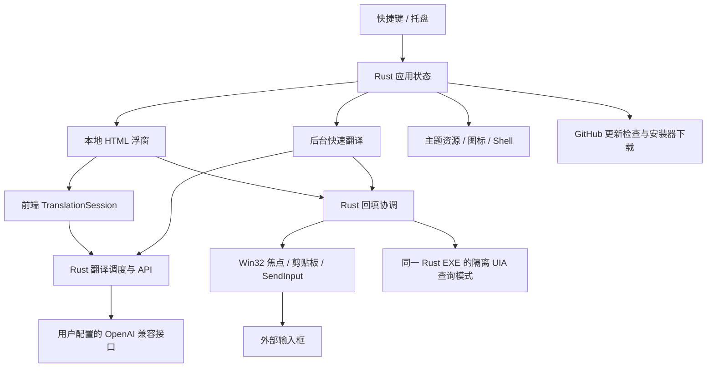
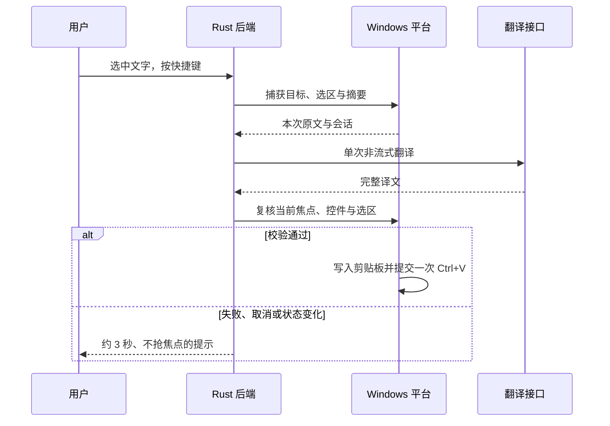

# 随译技术方案

本文描述 v0.3.1 的 **Tauri 2 + Rust** 实现。更新日期：2026 年 11 月 15 日。

[软件简介](../README.md) · [使用与配置](reference.md) · [安装与升级](installation.md) · [兼容性](compatibility.md) · [WPF 历史方案](technical-design-wpf.md)

## 范围与架构

随译是 Windows 常驻托盘翻译工具，当前提供中译英。普通模式在极简浮窗预览、编辑译文后回填；快速模式直接翻译并替换选区，失败仅显示短暂提示；托盘打开的复制模式不绑定外部输入位置。它不注册输入法，不采集逐键文本或完整聊天记录，不自动发送消息。

| 层次 | 实现与职责 |
| --- | --- |
| 窗口与托盘 | Tauri 2.12.5；五个本地 WebView 窗口：浮窗、设置、托盘菜单、提示、更新 |
| 界面 | 原生 HTML/CSS/JavaScript，无前端框架和远程页面；保留极简布局与自定义托盘菜单 |
| 业务后端 | Rust；翻译协议、状态版本、缓存、密钥保存、快捷键、目标捕获、回填、主题与更新 |
| 平台接口 | Win32、UI Automation、DPAPI、当前用户注册表及 Shell 属性存储 |
| 网络 | reqwest + Rustls；翻译与模型查询禁止自动重定向，更新下载自行校验重定向目标 |
| 安装分发 | 沿用 Inno Setup 6.7.3；保留安装身份、路径、覆盖更新与卸载逻辑，新增 WebView2 前置检测 |

产品继续以 `TranslationFloat.exe` 分发，应用身份保持 `Suiyi.Desktop`，方便旧安装版覆盖升级。生产包不包含 .NET、WPF 或 .NET 辅助进程，复用系统 WebView2 Runtime。



主要源码入口：

| 文件 | 职责 |
| --- | --- |
| [app.rs](../src-tauri/src/app.rs) | Tauri 生命周期、IPC、快捷键触发、普通与快速模式协调 |
| [native.rs](../src-tauri/src/native.rs)、[ffi.rs](../src-tauri/src/ffi.rs) | Windows 互操作、目标识别、选区读取、一次回填、快捷键线程、Shell 图标 |
| [api.rs](../src-tauri/src/api.rs) | 通用翻译协议、模型查询、超时、大小限制与错误归类 |
| [store.rs](../src-tauri/src/store.rs) | 配置、旧版兼容、DPAPI、偏好与登录启动项 |
| [theme.rs](../src-tauri/src/theme.rs) | 十种配色、深浅、对比度与主题图标 |
| [update.rs](../src-tauri/src/update.rs) | 版本判断、安装附件、受限下载与 SHA-256 校验 |
| [controller.js](../ui/controller.js)、[app.js](../ui/app.js) | 防抖、输入法组合状态、界面渲染与事件 |

`src/TranslationFloat.*` 和原有 .NET 检查保留作 WPF 历史参考，其中的图标源稿仍供构建使用；它们不进入 Tauri 运行包。开发用 WPF 测试编辑器及安装器持锁夹具仍需要 .NET，这与产品运行依赖分开。

## 生命周期与 IPC

普通启动通过 `Local\TranslationFloat.M0` 保持会话内单实例。重复启动的新实例退出；托盘操作或全局快捷键唤出原实例。浮窗与其他面板关闭时隐藏，托盘“退出”才关闭进程。

五类窗口统一采用透明、无系统装饰的外壳，关闭 Windows 原生窗口阴影，由页面面板绘制单层圆角细边。页面不留外圈空白，窗口高度按面板实际高度自适应，避免页面留白与原生边框叠加。模型列表相对模型输入框定位，不依赖窗口外边距。

全局快捷键由独立 Win32 消息线程注册，使用 `MOD_NOREPEAT`。默认 `Ctrl+Alt+T`，录入时临时释放原组合，保存新组合时先检查占用，再替换注册；失败恢复原组合。`Ctrl+Enter` 只在浮窗处理。

前端只能加载随包本地资源。CSP 禁止远程脚本与页面框架；翻译、模型查询和更新网络请求均在 Rust 中完成。敏感 IPC 按实际窗口 label 检查来源，例如只有设置窗口可以显式读取或保存密钥。外部译文、模型名称和错误提示通过文本或输入值渲染，不拼接成 HTML。

网络使用异步任务，跨进程窗口查询和粘贴放到阻塞工作线程。UIA 查询使用同一 EXE 的 `--inspect-focus`、`--inspect-selection` 模式，在 Tauri、托盘和配置初始化前运行并退出。父进程最多等 900 毫秒，超时终止辅助进程，输出限制 32 KiB。

## 翻译与界面状态

### 普通模式

快捷键先捕获目标与可读取选区，再显示浮窗。选区进入原文框，没有选区时允许手动输入；此前来自选区的草稿在无选区唤出时清空。

前端 `TranslationSession` 维护原文、译文、状态和递增 serial。原文变化立即禁用输出、清除旧译文并取消请求，输入法组合期间暂停请求，提交后防抖 450 毫秒。后台另外保证普通模式请求启动间隔至少 500 毫秒。

状态为 `empty`、`composing`、`waiting`、`translating`、`ready`、`edited`、`error`。只有本轮完整且非空的 `ready` / `edited` 译文可复制或回填；译文可手工编辑。前端 serial 和后端 generation 同时阻止迟到响应覆盖新内容或配置。

缓存最多 128 条、有效期 10 分钟，当前服务配置下按完整原文匹配；更改地址、模型或密钥时取消旧请求并清空缓存。429 的 `Retry-After` 约束后续调度，缺省等待 5 秒；不持续自动重试或切换服务商。

完整粘贴事件提交后清空原文与译文，隐藏浮窗。复制、取消或失败保留草稿；部分提交不重放。从托盘打开时只允许复制。窗口失去激活时使外部目标会话失效。

### 快速模式



快速模式不显示浮窗，不经过浮窗防抖与缓存；等待期间再次按快捷键取消。它只验证当前仍在原输入位置，不恢复用户已经切走的窗口。无选区、不可验证选区、未配置服务或翻译失败时停止。

## 目标与选区校验

目标会话保存唯一 ID、顶层窗口和原生焦点句柄、进程 ID、进程创建时间，以及可选的 UIA 控件运行时 ID 和选区摘要。进程名用于展示，不是应用白名单。

| 控件 | 路径 |
| --- | --- |
| 标准 Edit/RichEdit | 原生窗口类、启用/密码/只读样式检查，原生选区范围消息 |
| 可访问控件 | UIA 检查所属窗口、可编辑性和运行时 ID，通过 TextPattern 读取单个选区 |
| 只暴露顶层窗口的自绘控件 | 有原生焦点时允许普通模式尽力回填并提示确认；没有可靠选区时不支持快速替换 |
| 密码、只读、禁用、非输入或无法确认目标 | 拒绝绑定或回到复制模式 |

每个选区最多 2000 个 UTF-16 代码单元，多选区或过长时拒绝，不截断替换。UIA 只读取主动选择的文字和范围，不读取完整字段或控件名称。摘要包含选中文字与位置，绑定不保留 UIA 活对象。

标准编辑控件先确认非空选区，再执行一次 `Ctrl+C`；只读取新写入且归目标进程所有的 Unicode 剪贴板内容，并复核范围，不拿旧剪贴板翻译。此路径可能留下原选中文字，成功回填后留下译文。

回填顺序：

1. 固定目标与译文，忙碌标志阻止重复执行。确认会话、进程身份和窗口有效，等待快捷键相关按键释放，最多 600 毫秒。
2. 普通模式恢复目标并验证实际焦点；快速模式仅验证当前焦点。
3. 原生选区在写入译文前重新复制、比对内容，防止后续复制覆盖译文。
4. 写入 Unicode 剪贴板，占用最多重试 4 次，间隔 35 毫秒。关闭剪贴板后再记录最终序列号。
5. 再次验证会话、焦点、具体控件、选区和剪贴板序列号。变化时停止，已写入的译文留在剪贴板。
6. 消耗会话，一次批量提交完整 `Ctrl+V`。部分提交只释放合成按键，不再粘贴。

结果为 `rejected`、`submitted`、`uncertain`，复制另为 `copied`。`submitted` 仅表示按键事件完整提交，不能证明目标已写入文本。焦点、剪贴板和外部粘贴无法构成原子事务；用户仍需检查结果。程序不会自动发送消息、提升权限或执行撤销。

## 翻译接口

用户配置 API 根地址、Key、模型，无厂商或模型预设。地址接受 HTTP/HTTPS、路径前缀和完整 `/chat/completions` 地址，拒绝嵌入用户名、密码、查询或片段；公网连接应使用 HTTPS。

- 翻译使用 `POST chat/completions`，仅发送 `model`、`messages`、`stream: false`。Key 非空时使用 Bearer；为空时允许匿名接口。
- system 消息约束翻译，user 消息是本次原文，固定目标为英语。解析 `choices[0].message.content`，要求 `finish_reason: stop`。
- 多行要求 JSON `lines` 数组，核对行数、空行及条目内换行，重建原行结构；坏响应不输出。
- 模型使用 `GET models`，支持 `data[].id`、`has_more` / `last_id` 分页，去重、排序。查询失败仍可手填；列表不保证模型能进行聊天翻译。
- “测试”依次验证固定单行和带空行的多行输入。思考开关、温度和其他扩展字段不强制设置，独有协议及 Responses-only 模型当前不支持。

| 限制 | 当前值 |
| --- | --- |
| 原文 / 译文 | 2000 / 8000 个 UTF-16 代码单元 |
| 翻译超时 / 响应体 | 15 秒 / 64 KiB |
| 模型查询 | 总超时 15 秒，每页 2 MiB，最多 20 页、5000 个模型 |

认证、余额、限流、网络、超时、服务端和响应错误均转为固定提示，不向界面或日志暴露原始服务端错误正文。取消不能保证服务端已经停止计算或计费。

## 配置、主题与数据兼容

| 数据 | 位置 |
| --- | --- |
| 版本 2 API 地址与模型 | `%LOCALAPPDATA%\TranslationFloat\settings.json` |
| 各地址加密 Key | 同目录 `api-<归一化地址的 SHA-256>.key`，Windows DPAPI CurrentUser，无附加熵，兼容 WPF 密文 |
| 快捷键、快速模式、主题及启动偏好 | `HKCU\Software\Suiyi`：沿用 `HotKey`、`QuickModeEnabled`、`ThemeColor`、`AutoStartEnabled` |
| 登录启动 | `HKCU\Software\Microsoft\Windows\CurrentVersion\Run\Suiyi` |
| 图标与诊断 | 原用户目录的 `Icons`、`m0.log`；日志超过 256 KiB 轮换 |
| 草稿及翻译缓存 | 仅内存，不持久化历史 |

密钥按地址隔离，同地址留空保留已有 Key。旧版本 1 配置、`deepseek.key` 和限定旧 DeepSeek 地址的环境变量兼容来源继续保留。原安装用户无需重新填写接口和密钥。密钥小眼睛、失焦隐藏、跨地址清除已加载密钥及关闭清空控件继续保留。

默认开机启动开启，快速模式关闭，快捷键 `Ctrl+Alt+T`。便携版移动目录后重新运行，开启状态下更新登录启动路径。卸载保留配置与偏好，只移除指向本次安装位置的启动命令。

主题保留蓝、青、绿、青柠绿、黄、橙、粉、洋红、紫、黑十种颜色，默认橙色。后端读取 Windows `AppsUseLightTheme`，每 2 秒检查变化，更新各窗口 CSS 资源与托盘、任务栏图标；切换不重建编辑内容。

主题图标在 Rust 中按原标识几何生成，处理深浅对比度与多尺寸 ICO。为窗口设置 AppUserModel 重新启动图标资源；只刷新指向本程序的本地快捷方式，不重启 Explorer 或清空全局图标缓存。

只把本次原文发给用户配置的地址；更新查询使用不携带翻译 Key 的客户端。日志记录阶段、结果和进程名，不写原文、译文或凭据。DPAPI 保护落盘凭据，不能隔离同一 Windows 用户权限下的恶意进程。

## 安装与 WebView2

沿用安装身份 `Suiyi.Desktop` 和默认目录 `%LOCALAPPDATA%\Programs\Suiyi`，普通用户即可安装。安装器按以下流程处理依赖：

1. 检查系统级和当前用户 WebView2 Evergreen 注册信息。
2. 已安装时跳过下载及安装。
3. 缺少时，从微软 HTTPS 链接下载约 1.8 MiB 的 Bootstrapper。
4. 调用 Windows Authenticode 校验其签名有效且发布者为 Microsoft Corporation。
5. 执行 `/silent /install`，由微软引导程序下载适合当前设备的共享 Runtime，再复核安装状态；失败提供可重试的明确错误。

因此安装包不携带完整 WebView2；缺失组件的首次安装需要联网。便携版同样依赖 WebView2，缺少时应先运行随译安装包或手动安装微软 Runtime。

覆盖升级通过原退出事件和互斥量正常关闭运行实例。`legacy-wpf-files.iss` 精确列出旧版托管文件，删除旧 WPF 运行时，保留用户目录和未知文件，不使用通配符清理。

## 更新与发布

程序内更新继续查询本仓库最新正式 GitHub Release，验证草稿/预发布标志、版本、附件名、体积与 GitHub SHA-256。检查上限 15 秒、1 MiB。下载地址从固定仓库构造，HTTPS 重定向只允许指定 GitHub 附件域名；最多 256 MiB、总超时 10 分钟。

流式下载校验大小和 SHA-256，启动前再校验本地文件。关闭窗口取消下载并清理未交给安装器的临时文件；当前捕获、快速翻译、回填或设置未完成时等待用户点击安装。安装器继续接收 `/SUIYIUPDATE=1`，覆盖后重启随译，兼容 WPF 版的现有更新流程。摘要校验不等于代码签名。

推送 `vX.Y.Z` tag 后，GitHub Actions 安装固定 Rust 工具链、Node.js 与锁定的 Tauri CLI，运行检查、构建、隔离验证安装器、打包并发布四个附件：安装 EXE、便携 ZIP 及各自 `.sha256`。手动工作流仅生成产物，预发布 tag 不作为正式更新推送。

## 验证与构建

```powershell
# Rust 1.95.0、Node.js；首次会按锁文件安装 Tauri CLI
.\scripts\build.ps1
.\scripts\run.ps1 -Show -Diagnostics

# 安装包和便携包；本地打包不发布 Release
.\scripts\package.ps1 -Version 0.3.1

# 额外检查；安装器夹具需要 global.json 指定的 .NET SDK
cargo clippy --manifest-path src-tauri/Cargo.toml --all-targets -- -D warnings
.\scripts\test-installer.ps1 -AppDirectory .\artifacts\Tauri
```

当前检查包含前端异步状态、输入法组合、编辑与快捷键，Rust 协议、真实本地 HTTP 替身、取消与迟到响应、DPAPI/旧配置迁移、主题对比度、原生布局和更新校验。测试使用临时数据和虚构密钥，不调用真实翻译服务或读取生产密钥。

安装器用独立 AppId、目录、互斥量、事件和持锁夹具检查安装、覆盖升级、旧运行时清理及卸载。WebView2 的“缺失安装 / 已有跳过”使用隔离注册表和安装替身；微软真实下载链接与签名另行校验，不卸载用户电脑上共享的 WebView2。

GUI 联调用 `--test-profile <绝对目录>` 隔离服务配置、密钥和偏好，并禁用真实启动项修改；示例本地服务见 [mock-translation-server.mjs](../tools/mock-translation-server.mjs)。实测与限制记录在 [compatibility.md](compatibility.md)，WPF 时代的 187 项检查不作为 Tauri 版已通过检查数。

仍需扩大验证的范围包括更多外部浏览器与编辑器、微信等自绘控件选区、多屏混合 DPI、休眠恢复、高权限目标及极短时间的焦点/剪贴板竞争。流式输出、更多目标语言、本地模型管理和持久历史均未实现。
