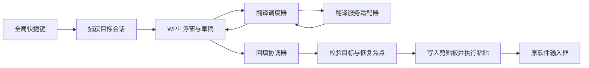

# Windows 翻译浮窗技术方案

采用 C#、WPF 和 .NET 10，做一个常驻托盘的 Windows 桌面工具。用户继续使用现有输入法，在紧凑浮窗里输入中文、预览和修改译文，再通过快捷键把译文填入原软件，由用户确认发送。

首版优先支持 Windows 11 x64。先验证微信等实际软件中的回填，再完成翻译接口和界面；以兼容性实测决定支持范围。以下数值为初始设计参数和验收目标，实施时根据测量调整。

设计日期：2026 年 11 月 14 日。

## 首版范围

| 首版实现 | 具体行为 |
| --- | --- |
| 常驻托盘 | 启动后驻留；托盘菜单提供打开、设置和退出 |
| 紧凑浮窗 | 原文在上、译文在下；支持拖动和跟随系统明暗主题 |
| 边写边译 | 默认停顿 450 毫秒后请求翻译，中文选词期间暂停 |
| 原文和译文编辑 | 原文最多 2000 个 UTF-16 码元；译文可以手动修改 |
| 中译英 | 第一条真实翻译链路；目标语言在代码中保持可扩展 |
| 文本回填 | 面向常见桌面及网页输入框，不限制应用名单；按场景记录兼容性 |
| 复制译文 | 即使回填目标不可用，仍可复制当前有效译文 |
| 草稿保留 | 取消或失败时保留；成功填入后清空，退出时清除 |
| 配置 | DeepSeek 模型和 API Key；当前固定中译英与唤出快捷键 |
| 免安装试用包 | 解压运行，运行时随应用发布 |

双栏布局、日语、流式展示、置顶后连续回填、历史记录、本地翻译模型和自动更新作为后续扩展。首版采用紧凑布局和完成后统一展示译文的方式，先把输入与回填链路做稳。

原型中的“撤销本次回填”只作用于模拟输入框。首版桌面程序不提供跨软件的专用撤销按钮，用户使用目标软件自己的撤销功能；外部软件可能合并编辑操作，浮窗无法创建通用的撤销事务。

## 交互约定

| 操作 | 结果 |
| --- | --- |
| 在目标输入框按 `Ctrl+Alt+T` | 在浮窗激活前记录目标，显示浮窗并聚焦原文 |
| 在浮窗内再次按唤出快捷键 | 收起浮窗，保留草稿 |
| 输入中文或修改原文 | 等待组合输入结束，再开始防抖计时 |
| 普通 `Enter` | 在原文或译文中换行 |
| `Ctrl+Enter` 或点击“填入” | 使用当前有效译文执行一次回填；提交完成后清空原文、译文并收起 |
| `Esc` 或关闭按钮 | 取消待执行的翻译，收起并保留草稿 |
| 点击其他应用 | 收起浮窗，使原目标会话失效；下次通过快捷键重新捕获 |
| 从托盘打开 | 恢复草稿，进入复制模式；取得新目标后再开放回填 |

回填遵循目标软件当前光标和选区的粘贴语义。用户唤出前选中了文字，回填可能替换该选区。程序不额外全选、不模拟消息发送键，也不读取完整聊天记录。

完整粘贴事件提交后，自动清空浮窗的原文和译文；仅复制、取消、失败及结果不确定时继续保留草稿。清空通过原文更新流程使旧请求失效，避免迟到的响应重新填回。每次唤出建立新的目标会话，避免自动沿用旧窗口。

## 技术选型

| 层次 | 选择 | 原因 |
| --- | --- | --- |
| 桌面界面 | WPF 和 XAML | 适合 Windows 浮窗、文本输入、快捷键和原生窗口互操作 |
| 运行时 | .NET 10 LTS | 选择长期支持版本，支持期覆盖到 2028 年 11 月 |
| 界面组织 | MVVM | 翻译状态、草稿和窗口表现分开，便于验证异步行为 |
| 全局快捷键 | Win32 `RegisterHotKey` | 只注册唤出组合键，处理占用冲突和退出释放 |
| 目标捕获 | Win32 窗口与 GUI 线程信息 | 在显示浮窗前记录前台窗口和焦点线索 |
| 回填 | 剪贴板 Unicode 文本和 `SendInput` 粘贴 | 先验证常见软件的文本粘贴链路 |
| 网络 | 复用 `HttpClient` | 支持取消、超时和明确的响应大小限制 |
| 配置与密钥 | JSON 和 Windows DPAPI | 普通配置可迁移，密钥按当前用户加密保存 |
| 托盘 | Windows Forms `NotifyIcon` | 在 WPF 主进程中提供托盘入口 |

WPF 是 Windows 专用的 .NET 桌面界面框架；.NET 10 是 LTS 版本。选择 WPF 的主要考虑是此项目集中在 Windows 窗口、输入焦点和快捷键，没有跨平台界面需求。[WPF 概述](https://learn.microsoft.com/en-us/dotnet/desktop/wpf/overview/) · [.NET 支持策略](https://dotnet.microsoft.com/en-us/platform/support/policy)

应用以普通用户权限运行，首版不注册系统输入法，不安装驱动、Windows 服务或浏览器扩展。Windows 10 和 ARM64 单独验证后再纳入支持范围。

## 模块和数据流



先用两个生产项目，避免为小工具过早拆出大量程序集。

```text
src/
  TranslationFloat.App/             WPF 主程序，net10.0-windows
    Views/                         浮窗和设置窗口
    ViewModels/                    界面状态和命令
    Platform/                      快捷键、目标捕获、剪贴板和回填
    SettingsWindow.xaml            DeepSeek 密钥与模型设置
    Storage/                       JSON 配置与 DPAPI 密钥
  TranslationFloat.Core/           调度、草稿、DeepSeek 协议和接口，net10.0
tests/
  TranslationFloat.Core.Tests/     异步竞争、版本与状态迁移
tools/
  TranslationFloat.TestTarget/      开发用输入框和回填验证程序
docs/
  translation-floating-window-plan.md
  compatibility.md                 实测后记录系统、软件版本和结果
```

核心接口保持简洁：

```csharp
public interface ITranslationProvider
{
    Task<string> TranslateAsync(
        TranslationRequest request,
        CancellationToken cancellationToken);
}

public interface ITargetCapture
{
    TargetCaptureResult CaptureBeforePopup();
}

public interface ITextInsertion
{
    Task<InsertionResult> InsertAsync(
        TargetSession target,
        string text,
        CancellationToken cancellationToken);
}
```

`TranslationController` 用统一递增版本管理原文、配置和编辑变化；`TranslationRequest` 携带原文与目标语言。`TargetSession` 包含会话标识、顶层窗口、焦点窗口线索和进程身份，有效性由回填平台检查。回填协调器接收不可变的目标与译文快照，执行期间不跟随界面变化改写内容。

## 翻译调度

### 版本与并发

每次修改原文、切换语言或更换翻译配置，都递增版本号。调度器取消旧请求，并在 450 毫秒无新输入后提交当前版本。

旧请求即使没有及时取消，也必须同时匹配草稿标识、原文版本和配置版本才能更新界面。网络取消不代表服务端停止计算，因此同时限制请求频率：初始上限为每秒两次，只保留一个最新待处理版本，防止连续输入积压请求。

原文与译文编辑都使用 WPF `TextCompositionManager` 维护组合输入状态。原文选词过程中不发请求，任一编辑区组合输入过程中不执行回填；原文组合结束后重新计时。关闭浮窗时取消调度，并使未完成结果失效；重新打开后，若当前草稿缺少有效译文，再发起翻译。

界面状态为：

```text
Empty → Waiting → Translating → Ready
                      └──────→ Error
Ready → 手动修改译文 → EditedReady
任意状态 → 修改原文或配置 → Waiting
```

只有 `Ready` 或 `EditedReady` 且译文非空、属于当前原文版本时，才能复制或回填。新请求期间可以保留旧译文供参考，但明确显示更新中，并禁用输出操作。

用户手动修改译文后，取消尚未完成的请求，并递增译文编辑版本，防止异步结果覆盖修改。再次修改原文会开始新一轮翻译。

### 超时与失败

| 情况 | 处理 |
| --- | --- |
| 未配置密钥 | 保留草稿，提示前往设置；不发送请求 |
| 网络不可用或 15 秒超时 | 保留原文，提供重试 |
| 认证失败 | 提示检查服务配置，不循环重试 |
| 限流 | 遵守服务返回的等待时间，合并期间的新输入 |
| 服务异常或空结果 | 当前版本进入失败状态，提供重试 |
| 响应超过约定大小 | 终止读取并报告响应异常 |

首版不做连续自动重试，也不在失败后自动切换其他服务商发送原文。响应体初始限制为 64 KiB，禁止网络工作阻塞 UI 线程。

可使用内存缓存保存最近 128 条、10 分钟内的译文。缓存键包括完整原文、语言、服务地址、模型和翻译配置版本；保留标点、换行与空白差异。退出进程清除缓存。

## 翻译引擎接入

当前接入 DeepSeek 官方 API，默认模型为 `deepseek-flash`，设置中也可选择 `deepseek-v4-pro`。测试使用独立的假服务与 HTTP 处理器模拟延迟、失败和乱序返回，不把模拟译文作为产品输出。

请求固定发送到 `https://api.deepseek.com/chat/completions`，使用 Bearer 认证、一条翻译约束 `system` 消息和一条原文 `user` 消息。设置 `thinking.type=disabled`、`stream=false`，只读取最终 `message.content`，不展示思考内容。遇到截断或非正常结束状态时拒绝输出。[DeepSeek 接口说明](https://api-docs.deepseek.com/api/create-chat-completion/)

接入约定：

- 初始固定中译英，源语言明确指定为中文；不把上下文不完整的输入当成多轮聊天。
- 首版收到完整译文后统一更新界面，后续可以扩展流式结果事件。
- 多行原文请求 JSON 行数组，核对行数、空行和条目内换行后还原原文行结构；单行原文使用纯文本输出。
- 请求通过 `HttpClient` 直接发送，服务商特有字段留在适配器中。
- API Key 由用户在设置中填写；个人试用版直接访问所配置的服务，无需自建后端。
- 设置中的连通性测试使用固定测试句，点击测试后才发送。

其他服务通过相同接口扩展，服务商特有参数留在适配器中；自定义服务地址和本地模型放在后续阶段。

对比引擎时使用 50 条固定中文样本，覆盖短句、省略主语、口语、时间、工作消息、标点和多行文本。记录完整请求延迟、错误率、实际用量，并人工判断原意、语气和是否增添内容。第一版不以服务商的“最快”宣传替代实测。

## 目标捕获与回填

这是开发的第一项技术验证。浮窗一旦获得焦点，原软件就不再是当前活动窗口，因此必须先捕获目标，再显示浮窗。

### 捕获目标

唤出快捷键触发后，读取 `GetForegroundWindow`、窗口所属进程和 GUI 线程，使用 `GetGUIThreadInfo` 获取焦点窗口线索。记录进程创建时间以辅助识别进程和句柄复用；无法获取必要身份信息时进入复制模式。

`GetGUIThreadInfo` 可查询其他进程的 GUI 线程，但在失去激活等情况下可能返回无效句柄。程序必须验证结果，不能只判断 API 调用成功。[GetGUIThreadInfo 文档](https://learn.microsoft.com/en-us/windows/win32/api/winuser/nf-winuser-getguithreadinfo)

当前版本已移除 M0 的进程白名单，不能仅凭“进程是微信或浏览器”判断当前焦点可编辑。标准 Edit/RichEdit 通过窗口样式识别密码与只读状态，并检查启用状态。其他控件由只读 UI Automation 查询焦点、所属窗口、可编辑性及运行时身份；已识别的密码、只读、禁用及非输入控件拒绝回填。名称映射只用于显示。

UI Automation 已投入运行路径，使用同一可执行文件的短生命周期 `--inspect-focus` 模式。每次最多等待 900 毫秒，超时终止辅助进程。仅查询控件元数据，不读取可访问名称、值或正文，也不加载翻译配置。标准编辑控件走原生路径，不启动辅助进程。

能取得可编辑控件身份时，在回填前复核同一身份。缺少原生焦点且无法取得可验证的 UIA 身份时，只开放复制。对于微信等只暴露窗口的自绘界面，或辅助查询不可用但仍有原生焦点的情况，保留显式唤出后的尽力回填，并提示先确认光标；此路径不宣称精确识别具体字段，也不保证识别所有自绘密码或只读控件。

浮窗显示期间，如果用户切换到其他应用，目标会话失效。回填后的会话也立即失效。新一轮回填需要在目标输入位置重新唤出，不能把旧目标自动替换成当时恰好位于前台的窗口。

### 执行一次回填

1. 固定当前译文和目标快照，进入执行状态，禁止双击和重复快捷键触发。
2. 检查目标窗口存在、进程身份匹配、会话未失效，且译文属于当前原文版本。
3. 等待用户松开快捷键涉及的修饰键。初始等待上限 600 毫秒，超时则停止，不替用户释放物理按键。
4. 请求恢复原窗口到前台；在有限时间内验证真实前台窗口和可验证的焦点信息。
5. 将译文写入 Unicode 文本剪贴板。占用时做有限次数、短间隔重试，失败则停止。
6. 再次校验前台目标、会话、控件启用/原生样式；如有 UIA 控件身份，异步复核身份，再检查会话和剪贴板版本，通过一次 `SendInput` 批量输入粘贴组合键。
7. 根据执行结果反馈状态，消耗此次目标会话；按默认交互收起浮窗。

Windows 会限制前台窗口切换，即使满足部分条件也可能拒绝；请求调用成功也不能替代对实际前台窗口的校验。恢复失败时保留浮窗和复制入口。[SetForegroundWindow 文档](https://learn.microsoft.com/en-us/windows/win32/api/winuser/nf-winuser-setforegroundwindow)

`SendInput` 受进程完整性级别限制，其返回值只表示插入输入流的事件数量。首版遇到高权限程序或部分注入结果时停止，不通过提升权限或自动追加输入方式绕过。[SendInput 文档](https://learn.microsoft.com/en-us/windows/win32/api/winuser/nf-winuser-sendinput)

此链路只能检查注入前的状态，无法把跨进程焦点、剪贴板和目标软件的粘贴处理组成原子事务。目标识别不充分或焦点不稳定的场景使用复制模式；对兼容场景仍保留“由用户在原软件确认发送”的最后一步。

### 结果语义

| 结果 | 界面行为 |
| --- | --- |
| 注入前失败 | 提示原因并保留复制入口，用户可以重新捕获目标 |
| 输入事件已提交，目标内容未验证 | 显示“已执行粘贴，请确认输入框内容” |
| 目标适配器明确确认插入 | 可以显示“译文已填入” |
| 部分事件提交或提交后状态不明 | 提示检查目标内容，禁止自动重试，避免重复插入 |

首版通用路径默认属于“已提交但未验证”。不要为了显示成功而读取目标软件的完整文本，也不要在一次提交后自动尝试第二种输入方式。

### 剪贴板与撤销边界

首版回填会把译文复制到系统剪贴板，并在操作后保留译文。设置页明确说明此行为，不用固定延时自动恢复旧剪贴板，以免目标软件稍后读取到错误内容。

写入后记录 `GetClipboardSequenceNumber`。注入前若剪贴板发生变化则停止，不覆盖用户的新复制内容。序列号仅用于检测变化，不能当作目标完成粘贴的确认。[剪贴板序列号文档](https://learn.microsoft.com/en-us/windows/win32/api/winuser/nf-winuser-getclipboardsequencenumber)

后续如增加旧剪贴板恢复，必须单独处理多格式、延迟渲染及读取完成时机。首版不向原软件自动发送 `Ctrl+Z`，避免撤销用户的其他编辑。

## Windows 窗口行为

全局唤出键采用 `RegisterHotKey` 和 `MOD_NOREPEAT`。注册失败时提示改键，并保留托盘入口。`Ctrl+Enter` 只在浮窗内部处理和消费，不注册成桌面全局回填键。[RegisterHotKey 文档](https://learn.microsoft.com/en-us/windows/win32/api/winuser/nf-winuser-registerhotkey)

浮窗初始宽度约 440 DIP，优先出现在原输入位置附近。取得可靠光标位置时做坐标与 DPI 转换；否则使用鼠标所在显示器上的工作区位置。两条路径都需要避开任务栏、限制在可见区域，并允许用户拖动调整。坐标只用于摆放浮窗，不通过模拟点击坐标恢复输入位置。

应用声明 Per Monitor V2 DPI 感知，验证 100%、125%、150%、200% 缩放和多显示器负坐标。首次唤出把焦点交给原文框，后续保留草稿的编辑位置。

进程使用当前用户会话内的单实例机制。关闭浮窗只隐藏窗口，托盘“退出”才结束进程，并释放快捷键、托盘资源和请求。退出按钮不触发消息发送。

## 本地数据与设置

数据保存到 `%LOCALAPPDATA%\TranslationFloat\`：

| 数据 | 保存方式 |
| --- | --- |
| 界面位置、快捷键、服务配置 | `settings.json`，带配置版本，临时文件写完后替换 |
| API Key | `deepseek.key`，DPAPI `CurrentUser` 加密；不写入 JSON |
| 原文、译文和翻译缓存 | 默认只在内存，退出清除 |
| 诊断日志 | 操作阶段、结果、进程名和窗口句柄；不写原文、译文、密钥或窗口标题 |

DPAPI 提供按用户或机器凭据保护数据的能力，适合本地保存 API Key；当前用户范围不保护同一用户下已被恶意控制的进程。[ProtectedData 文档](https://learn.microsoft.com/en-us/dotnet/api/system.security.cryptography.protecteddata)

只把用户主动在浮窗中输入的原文发给已配置的翻译服务。首版不采集其他软件中的逐键输入、不自动上传选区或聊天记录，也不内置共享密钥。默认不开启开机启动，后续由用户在设置中开启。

普通配置损坏时回到默认模型，并独立读取加密密钥；密钥解密失败时要求重新填写。服务返回的原始错误正文可能包含请求内容，界面仅显示归类后的固定提示。

## 开发顺序与验收

| 阶段 | 工作 | 完成条件 |
| --- | --- | --- |
| M0 回填验证 | 做最小浮窗和固定译文；验证目标捕获、焦点恢复、粘贴与失败出口 | 在实际微信、记事本和浏览器输入框记录结果；明确哪些场景可回填 |
| M1 交互闭环 | 紧凑界面、托盘、快捷键、草稿、调度和错误状态 | 使用现有中文输入法完成输入、修改、收起、重开和复制 |
| M2 真实翻译 | DeepSeek 适配器、密钥设置、取消、限流及缓存 | 用真实服务完成中译英；乱序结果不覆盖新输入 |
| M3 日用验证 | DPI、多屏、异常、兼容性回归和发布包 | 在干净 Windows 环境解压运行，输出兼容性清单 |

M0 是继续扩展回填范围的依据。若微信的当前版本无法可靠恢复输入焦点，应先解决该场景或明确提供复制模式，再增加引擎和界面选项。

粗估约 8 至 15 个开发人日达到首个可日用试用版，按熟悉 C# 和 Windows 桌面开发、复用现成翻译 API 估算。完成 M0 后修正排期；安装器、签名和自动更新单独安排。

### 必须覆盖的验证

| 类别 | 验证内容 |
| --- | --- |
| 中文输入 | 微信输入法、微软拼音；选词 Enter 不触发回填，组合期间不发请求 |
| 异步竞争 | 慢旧请求、取消无效、快速改文、切换语言、手动修改译文、隐藏后结果返回 |
| 目标变化 | 原窗口关闭、切换应用、切换会话、句柄复用、焦点恢复失败 |
| 回填 | 空输入框、已有文字、选区替换、多行、Emoji、连续按快捷键和双击 |
| 失败出口 | 剪贴板被占用或改变、权限不匹配、部分输入提交、用户仍按住修饰键 |
| 网络 | 离线、超时、401/403、429、服务错误、空响应和过大响应 |
| 桌面 | 多屏缩放、屏幕边缘、休眠恢复、快捷键被占用和重复启动 |

纯状态与调度使用可控制时钟、可乱序返回的假服务测试，不依赖真实网络。真实软件中的焦点、输入和剪贴板行为必须在 Windows 上做集成验证，记录系统和应用版本。

初始性能目标：后台常驻后唤出浮窗 P95 小于 200 毫秒；输入与窗口操作不等待网络；对 100 字以内样本分别记录服务请求延迟和包含 450 毫秒停顿的总耗时。引擎端延迟以实际账号、地域和网络测量为准。

回填验证每个启用场景至少连续执行 30 次；出现一次填入错误目标、自动发送、重复粘贴或丢失草稿，即停止开放该场景并修正。30 次通过只作为版本回归门槛，不代表任意软件兼容性保证。

## 构建与交付

应用目标框架使用 `net10.0-windows`。首版发布自包含的 `win-x64` 文件夹压缩包，保留 WPF 所需程序集，不开启裁剪；在未安装 .NET 的干净环境验证运行。随后按实际分发需要增加签名安装器。

开发环境的 .NET 10 SDK 10.0.404 已准备在项目 `.tools/dotnet` 中，版本锁定在 `global.json`；系统 PATH 保持不变。真实联调使用用户在本机设置窗口保存的 DeepSeek 凭据。

已完成 M0 回填验证，并接入 DeepSeek，跑通原文输入、真实翻译、编辑译文、收起重开和微信回填。当前版本已扩展为通用输入框回填，实测 WPF、Edge textarea/contenteditable，并验证只读和密码字段拦截，记录见 [回填验证记录](compatibility.md)。M3 的多屏、高权限场景和连续回归继续单独验证。
